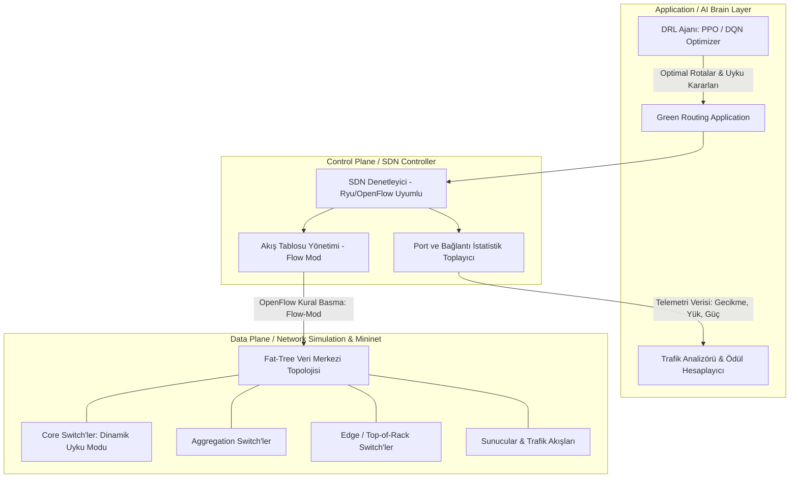

# Akıllı Ağ Yönetimi İçin Pekiştirmeli Öğrenme (RL) Destekli Yeşil Yönlendirme (Green SDN)

## 1. Proje Özeti ve Vizyonu

Bu proje, modern veri merkezi ağlarında (Data Center Networks - DCN) ve SDN (Yazılım Tanımlı Ağlar) ortamında enerji verimliliğini maksimize etmek için geliştirilmiş **Pekiştirmeli Öğrenme (Reinforcement Learning - RL)** tabanlı akıllı bir ağ optimizasyon sistemidir.

Mininet ve SDN (OpenFlow / Ryu Controller) mimarisiyle %100 uyumlu olarak tasarlanan bu sistem, ağdaki dinamik trafik taleplerini izler, hizmet kalitesinden (QoS - gecikme, paket kaybı, bant genişliği) ödün vermeksizin trafiği birleştirir (traffic consolidation) ve kullanılmayan omurga bağlantılarını/anahtarlarını dinamik olarak enerji tasarrufu (Sleep / Low Power) moduna geçirir.

---

## 2. Sistem Mimarisi (3 Katmanlı SDN Yaklaşımı)

---

## 3. Mininet Uyumu ve Hibrit Çalışma Modeli

Proje iki yönlü çalışacak şekilde yapılandırılmıştır:

1. **Yüksek Hızlı Dijital İkiz Simülasyonu (Windows Native):**
   * Gymnasium ve NetworkX üzerinde binlerce adım/saniye hızında çalışarak RL ajanının dakikalar içinde eğitilmesini sağlar.
   * Canlı, modern web tabanlı simülasyon paneli bu motor üzerinden anlık 60 FPS görselleştirme sunar.

2. **Mininet & SDN Dışa Aktarıcısı (Mininet Topology & Ryu Controller Script Generator):**
   * Eğitilen model ve topoloji, doğrudan Mininet (`mininet_topology.py`) ve Ryu SDN Controller (`green_controller.py`) koduna dönüştürülür.
   * Böylece Mininet üzerinde `sudo mn --custom ...` komutuyla da birebir doğrulanabilir.

---

## 4. Matematiksel Modelleme (MDP & Enerji Formülasyonu)

### 4.1. Enerji Tüketim Modeli

Bir anahtarın ($s$) güç tüketimi şasi taban gücü ve aktif portlarının hızına göre modellenir:

$$P_{total} = \sum_{s \in S} \Big( P_{base} \cdot \alpha_s + \sum_{p \in Ports(s)} P_{port}(v_p) \cdot \beta_p \Big)$$

* $\alpha_s \in \{0, 1\}$: Anahtarın aktif (1) veya uyku modunda (0) olduğunu belirtir.
* $\beta_p \in \{0, 1\}$: Portun aktif/uyku durumunu belirtir.
* $P_{base}$: Boşta çalışma (idle) taban gücü (ör. 150W).
* $P_{port}$: Port veri aktarım gücü (ör. 10G port için 15W).

### 4.2. Durum Uzayı ($S$)

* Bağlantı kullanım oranları (link utilization): $U_e \in [0, 1]$
* Kuyruk doluluk oranları ve tahmini gecikmeler: $Q_e$
* Mevcut aktif/uyku matrisi: $A_e \in \{0, 1\}$
* Gelen trafik akış matrisi: $T_{demand}$

### 4.3. Eylem Uzayı ($A$)

* Akışların yönlendirileceği alternatif omurga patikaları (K-Shortest Paths / ECMP alternatifleri).
* Hacmi sıfıra inen bağlantı ve anahtarları kapatma/açma kararları.

### 4.4. Ödül Fonksiyonu ($R$)

$$R = - \Big( w_{energy} \cdot \frac{P_{total}}{P_{max}} + w_{delay} \cdot \frac{\bar{D}}{D_{max}} + w_{loss} \cdot LossRate + w_{penalty} \cdot SLA\_Violation \Big)$$

---

## 5. Karşılaştırma (Benchmark) Stratejisi

Ajanın başarısı 3 farklı metodoloji ile kıyaslanacaktır:

1. **OSPF / Dijkstra (Standart En Kısa Yol):** Enerji farkındalığı yoktur, tüm cihazlar açıktır.
2. **ECMP (Equal-Cost Multi-Path):** Trafiği tüm yollara homojen yayar, gereksiz yere tüm core switch'leri uyanık tutar.
3. **Green DRL (Bizim Ajanımız):** Düşük ve orta yüklerde trafiği minimum sayıda omurga anahtarına konsolide eder, kullanılmayanları uyutarak **%25 - %45 enerji tasarrufu** elde eder.

---

## 6. İnteraktif Simülasyon Paneli (Dashboard) Özellikleri

* **Canlı Ağ Topolojisi:** Renkli bağlantı yükleri (Mavi $\rightarrow$ Yeşil $\rightarrow$ Turuncu $\rightarrow$ Kırmızı).
* **Uyku Modu Görselleştirmesi:** Pasif hale getirilen switch ve linkler eko modunda (soluk yeşil / sleep simgeli).
* **Canlı Kıyaslama Grafikleri:** OSPF vs ECMP vs RL Enerji Tüketimi (kW), Karbon Tasarrufu, Ortalama Gecikme (ms).
* **Gerçek Zamanlı Senaryo Enjeksiyonu:**
  * *"Trafik Patlaması (DDoS / Peak Demand)"* $\rightarrow$ Ajanın uyuyan portları otomatik uyandırma hızını gözlemleme.
  * *"Bağlantı Çökmesi (Link Failure)"* $\rightarrow$ Hızlı yeniden rota kurma (failover) yeteneği.
