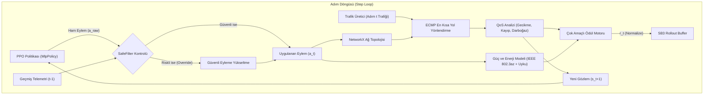
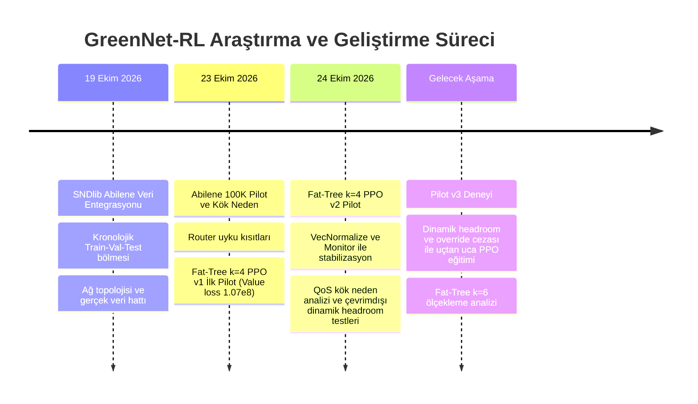

# GreenNet-RL 🌿

**Pekiştirmeli Öğrenme ile Enerji Verimli Ağ Trafiği Optimizasyonu**

[](https://www.python.org/downloads/release/python-3120/)
[](https://gymnasium.farama.org/)
[](https://stable-baselines3.readthedocs.io/)
[](https://pytorch.org/)
[]()

---

## İçindekiler
1. [Proje Hakkında](#1-proje-hakkında)
2. [Sistem Mimarisi ve Matematiksel Model](#2-sistem-mimarisi-ve-matematiksel-model)
3. [Ağ Topolojileri](#3-ağ-topolojileri)
4. [Kurulum ve Doğrulama](#4-kurulum-ve-doğrulama)
5. [Çalıştırma, Eğitim ve Analiz Komutları](#5-çalıştırma-eğitim-ve-analiz-komutları)
6. [Deneysel Bulgular: PPO v1 vs. PPO v2 Karşılaştırması](#6-deneysel-bulgular-ppo-v1-vs-ppo-v2-karşılaştırması)
7. [Kontrollü QoS Kök Neden ve İyileştirme Deneyleri (Pilot v3 Temeli)](#7-kontrollü-qos-kök-neden-ve-iyileştirme-deneyleri-pilot-v3-temeli)
8. [Akademik Sınırlar ve Bilinen Kısıtlar](#8-akademik-sınırlar-ve-bilinen-kısıtlar)
9. [Teknik Revizyon Günlüğü](#9-teknik-revizyon-günlüğü)
10. [Proje Dizin Yapısı](#10-proje-dizin-yapısı)
11. [Geliştirme Yol Haritası](#11-geliştirme-yol-haritası)

---

## 1. Proje Hakkında

**GreenNet-RL**, veri merkezi ağlarında (Data Center Networks - DCN) ve geniş alan ağlarında (WAN) dinamik trafik dalgalanmalarına uyum sağlayarak ağ omurgasındaki gereksiz anahtarları ve bağlantıları derin uyku (chassis deep-sleep) veya düşük güç durumuna (IEEE 802.3az EEE/LPI) geçiren, bunu yaparken Hizmet Kalitesi (QoS - Quality of Service) gereksinimlerini (gecikme, paket kaybı, SLA ihlali) koruyan bir **Pekiştirmeli Öğrenme (Reinforcement Learning - RL)** araştırma ortamıdır.

Klasik yönlendirme mekanizmaları (OSPF/ECMP), ağ trafiği dip noktadayken dahi tüm omurga anahtarlarını tam kapasitede çalıştırarak ciddi bir enerji israfına yol açar. GreenNet-RL; **NetworkX** graf mimarisi, **Gymnasium** uyumlu MDP simülasyonu, **Stable-Baselines3 PPO** ajanı ve kural-tabanlı **SafeFilter** güvenlik mekanizmasını bir araya getirerek ağdaki enerji–QoS ödünleşimini (trade-off) çok amaçlı ödül optimizasyonu ile çözer.

---

## 2. Sistem Mimarisi ve Matematiksel Model

### A. Mimari Akış Diyagramı



### B. Çok Amaçlı Ödül Fonksiyonu

Ajanın optimizasyon hedefi, enerji tasarrufunu maksimize ederken QoS cezalarını minimize etmektir:

$$
R_t = \left( R_{\text{energy}} - P_{\text{waste}} - P_{\text{delay}} - P_{\text{loss}} - P_{\text{congestion}} - P_{\text{switching}} - P_{\text{flapping}} - P_{\text{wakeup}} - P_{\text{override}} \right) \times \text{scale}
$$

#### 1. Enerji Tasarrufu Ödülü ($R_{\text{energy}}$)

$$
R_{\text{energy}} = \frac{N_{\text{total\_cores}} - N_{\text{active\_cores}}}{N_{\text{total\_cores}}} \times 16.0 \times \frac{w_e}{2.5}
$$

Fat-Tree k=4 için:
- 1 Core aktifken: $R_{\text{energy}} = 12.0$ (%75 tasarruf)
- 2 Core aktifken: $R_{\text{energy}} = 8.0$ (%50 tasarruf)
- 4 Core aktifken: $R_{\text{energy}} = 0.0$ (%0 tasarruf)

#### 2. Aşırı Tahsisat / İsraf Cezası ($P_{\text{waste}}$)

Talep düşükken gereksiz omurga anahtarlarının açık tutulmasını cezalandırır ($N_{\text{active}} > N_{\text{safe}}$ ve $\text{MaxUtil} < 0.70$ olduğunda):

$$
P_{\text{waste}} = (N_{\text{active}} - N_{\text{safe}}) \times 3.5 \times w_{\text{waste}}
$$

#### 3. Gecikme Cezası ($P_{\text{delay}}$)

Trafik ağırlıklı uçtan uca ortalama gecikme ve SLA eşik aşımı cezası:

$$
P_{\text{delay}} = \frac{D_{\text{avg}}}{2.5} \times w_d + \max\left(0, D_{\text{avg}} - \text{SLA}_{\text{delay}}\right) \times 6.0 \times w_d
$$

#### 4. Paket Kaybı Cezası ($P_{\text{loss}}$)

$$
P_{\text{loss}} = (\text{Loss}_{\text{rate}} \times 50.0) \times w_{\text{loss}} \times \text{cfg}_{\text{loss}}
$$

#### 5. Geçiş ve Kararsızlık Cezaları ($P_{\text{switching}}, P_{\text{flapping}}, P_{\text{wakeup}}$)

Anahtarların sürekli açılıp kapanmasını, minimum bekleme süresini (dwell time < 3 adım) ve anahtar uyanma enerji maliyetlerini sınırlar.

#### 6. Güvenlik Filtresi Müdahale Cezası ($P_{\text{override}}$)

Ajanın güvenli olmayan ham eylemler seçip SafeFilter'a tembelce yaslanmasını cezalandırmak üzere yapılandırılabilir bileşen (varsayılan: 0.0).

### C. SafeFilter Güvenlik Mekanizması

SafeFilter, ajanın önerdiği eylemin ($a_{\text{raw}}$) ağda tıkanıklık veya SLA ihlali yaratıp yaratmayacağını geçmiş telemetri ($t-1$) ve güvenlik marjı ($h$) üzerinden denetler:
- Eylem güvenliyse doğrudan uygulanır.
- Eylem güvensizse (tahmini doluluk > %85 veya tahmini gecikme > SLA), sistem eylemi en az güç tüketen güvenli üst eyleme (örneğin 1 core $\rightarrow$ 4 core) yükseltir.

---

## 3. Ağ Topolojileri

| Topoloji | Düğüm Sayısı | Anahtar Dağılımı | Bağlantı Sayısı | Bant Genişliği | Durum |
|---|---|---|---|---|---|
| **Fat-Tree k=4** | 20 Switch, 16 Host | 4 Core, 8 Aggregation, 8 Edge | 48 Link (32 omurga/pod + 16 host) | 1.0 Gbps / link (16 Gbps omurga bisection) | **PPO v1 ve v2 Pilotları Tamamlandı** (Genel QoS güvenlik hedefleri henüz karşılanmadı) |
| **Fat-Tree k=6** | 45 Switch, 54 Host | 9 Core, 18 Aggregation, 18 Edge | 162 Link | 1.0 Gbps / link | **Altyapı Hazır (Henüz PPO Eğitimi Yapılmadı)** |
| **SNDlib Abilene** | 12 Router (PoP) | WAN Omurga Grafı | 30 Yönlü Link (15 Çift) | 2.5 Gbps / link | **Pilot Eğitildi** (48.096 gerçek talep matrisi) |

> [!IMPORTANT]
> **Fat-Tree k=6 Durumu**: k=6 topolojisi kod mimarisinde, eylem haritalamasında ve test paketinde tam desteklenmektedir; ancak donanım ve süre sınırları gereği **k=6 üzerinde henüz uzun PPO eğitimi başlatılmamıştır**.

---

## 4. Kurulum ve Doğrulama

**Gereksinimler:** Python **3.12** önerilir (`numpy<2.0.0` uyumluluğu için).

```powershell
# 1. Depoyu klonlayın ve kök dizine geçin
git clone https://github.com/ozkn-sefa/GreenNet-RL.git
cd GreenNet-RL

# 2. Sanal ortamı oluşturun ve etkinleştirin (Windows PowerShell)
py -3.12 -m venv .venv
.\.venv\Scripts\Activate.ps1

# 3. Bağımlılıkları kurun
python -m pip install --upgrade pip
python -m pip install -r requirements.txt
python -m pip install pytest

# 4. Regresyon test paketini çalıştırın
python -m pytest tests -q
```

**Mevcut Test Durumu:** Tüm test paketi yerel ortamda çalıştırılmış ve eksiksiz olarak geçmiştir (**115 passed**; otomatik CI/CD entegrasyonu yerine yerel pytest koşturulmaktadır).

---

## 5. Çalıştırma, Eğitim ve Analiz Komutları

Aşağıdaki komutların tamamı geçerli proje dosyalarına dayanmakta olup doğrulanmıştır:

### A. İnteraktif Simülatör ve Web Paneli
FastAPI ve WebSockets tabanlı yerel izleme arayüzü:
```powershell
python run.py --host 127.0.0.1 --port 8000
```
Tarayıcıda `http://127.0.0.1:8000` adresinden canlı simülasyon adımlarını ve telemetriyi izleyebilirsiniz.

### B. Fat-Tree k=4 Pilot Eğitimi (Kontrollü Smoke Test)
Eğitim betiğinin doğrulanması için 2048 adımlık hızlı test:
```powershell
python scripts/train_pilot_fattree_k4.py --smoke-test
```
*(Tam 100K pilot eğitimi `--steps 100000` ile yürütülür; yeni tam eğitim başlatmadan önce onay alınmalıdır).*

### C. Teşhis ve Adım Adım İnceleme (Diagnose QoS)
PPO, OSPF ve Heuristic ajanların adım bazında darboğaz ve telemetri gecikmesini incelemek için:
```powershell
python scripts/diagnose_k4_qos.py
```

### D. Kontrollü SafeFilter ve Dinamik Headroom Deneyi
Birebir aynı başlangıç ve RNG koşullarında SafeFilter açık/kapalı ve dinamik headroom karşılaştırması:
```powershell
python scripts/controlled_safefilter_experiment.py
```

### E. Checkpoint Veri Doğrulama
Mevcut model checkpoint kayıtlarını ham JSON sonuçlarıyla doğrulamak için:
```powershell
python scripts/verify_checkpoint_tables.py
```

---

## 6. Deneysel Bulgular: PPO v1 vs. PPO v2 Karşılaştırması

Fat-Tree k=4 üzerinde icra edilen ilk 100K pilot (v1: normalizasyonsuz) ile ikinci kontrollü 100K pilot (v2: `VecNormalize(norm_reward=True, clip_reward=inf)` + `Monitor`) arasındaki doğrulanmış sonuçlar:

### A. Değer Fonksiyonu ve Öğrenme Kararlılığı
| Metrik | Pilot 1 (v1: VecNormalize Yok) | Pilot 2 (v2: VecNormalize + Monitor) | Açıklama |
|---|---|---|---|
| **Value Loss** | **$1.07 \times 10^8$ ($107,000,000$)** | **0.001 – 0.05 (Ort. ~0.01)** | Sayısal patlama önlendi, kritik ağı normalize varyansla stabilize edildi |
| **`ep_rew_mean` Telemetrisi** | 0.0 (Kayıt açığı) | **-65K .. -239K (Gerçek getiriler)** | `Monitor` wrapper ile bölüm getirileri eksiksiz kaydedildi |
| **Bölüm Uzunluğu** | 0.0 | **1024.0 Adım** | Bölüm takibi doğrulandı |

> [!NOTE]
> **Ölçek Uyarısı**: Pilot 1'deki `value_loss` ham birim karedir ($(r - V)^2$). Pilot 2'de ise getiri dinamik standart sapmaya bölündüğünden ($\frac{(r - V)^2}{\sigma_R^2}$) boyutsuz varyans hatasıdır; doğrudan sayısal kıyaslama yerine kararlılık mertebesi esas alınmalıdır.

### B. Validasyon Rejimleri Performansı (Düzeltilmiş 20K ve 100K Checkpoint'leri)
*(50'şer adımlık deterministik validasyon pencereleri; 20K verileri ham JSON'dan düzeltilmiştir)*:

| Rejim | Checkpoint | PPO Güç (W) | PPO Tasarruf | PPO Kayıp | PPO Gecikme | PPO SLA İhlali | SafeFilter Override | OSPF Kayıp | OSPF SLA İhlali |
|---|---|---|---|---|---|---|---|---|---|
| **Low (0.50x)** | **20K** | 2747.7 W | %7.06 | %0.28 | 0.838 ms | %4.0 | %2.0 | %0.00 | %0.0 |
| | **100K** | 2556.7 W | %13.52 | %0.28 | 0.852 ms | %4.0 | %8.0 | %0.00 | %0.0 |
| **Medium (1.10x)** | **20K** | 2881.3 W | %5.88 | %2.57 | 2.397 ms | %14.0 | %36.0 | %1.48 | %8.0 |
| | **100K** | 2766.4 W | %9.63 | %3.54 | 2.910 ms | %16.0 | %44.0 | %1.48 | %8.0 |
| **High (1.85x)** | **20K** | 3144.5 W | %1.32 | %16.55 | 9.945 ms | %60.0 | %80.0 | %16.62 | %62.0 |
| | **100K** | 3138.8 W | %1.50 | %16.55 | 9.945 ms | %60.0 | %76.0 | %16.62 | %62.0 |
| **Burst (2.50x)** | **20K & 100K** | 3751.3 W | %0.00 | %84.06 | 76.519 ms | %100.0 | %100.0 | %84.06 | %100.0 |

---

## 7. Kontrollü QoS Kök Neden ve İyileştirme Deneyleri (Pilot v3 Temeli)

`REVISION_LOG.md` Bölüm 15 kapsamında gerçekleştirilen çevrimdışı ve kontrollü testlerin bulguları aşağıda özetlenmiştir:

### A. SafeFilter Zamanlama ve Kredi Ataması Maskelemesi
- **1-Adım Telemetri Gecikmesi**: SafeFilter güvenlik projeksiyonunu $t-1$ anının telemetrisi üzerinden yapar. Ani trafik artışlarında (örneğin Adım 0'daki 514 Mbps'den Adım 1'deki 3090 Mbps'ye %600 sıçrama), SafeFilter 1 core'u güvenli sanarak onaylar ve omurgada %29.53 kayıp meydana gelir.
- **Öğrenme Maskelemesi**: Yüksek yükte PPO riskli 1-core seçtiğinde SafeFilter eylemi 4-core'a yükseltirse, ağ kurtulur ve PPO'ya filtrelenmiş güvenli durumun ödülü döner (~ -0.86). PPO riskli eylemi için cezalandırılmadığı için SafeFilter'a yaslanmayı öğrenir.

### B. Dinamik Headroom Ampirik Testi (50 Adımlık Medium Dizisi, Seed 60002)
Geleceğe dair hiçbir veri sızıntısı olmaksızın, yalnızca geçmiş telemetri türevine ($t-1$ ile $t-2$ farkı) dayalı dinamik headroom ($h_{\text{dyn}}$) eğitimsiz olarak test edilmiştir:

| Metrik | Sabit Headroom (1.20x) | Dinamik Headroom (Türev Tabanlı) | Değişim / Etki |
|---|---|---|---|
| **Ortalama Paket Kaybı** | **%3.54** | **%3.46** | **-0.08 puan iyileşme** |
| **Ortalama Gecikme** | **2.937 ms** | **2.832 ms** | **-0.105 ms iyileşme** |
| **SLA İhlal Oranı** | %16.0 | %16.0 | Değişmedi (Kenar/Host darboğazı) |
| **SafeFilter Override Oranı** | %42.0 | %46.0 | +4.0 puan (Daha proaktif koruma) |
| **Ortalama Güç Tüketimi** | 2747.3 W | 2779.6 W | **+32.3 W (%1.1 ek güç maliyeti)** |

### C. Override Cezası Seçenekleri (0.0, -2.0, -5.0)
SafeFilter müdahale ettiğinde PPO'ya override cezası verilmesi seçeneği kod seviyesinde doğrulanmıştır:
- **Ağırlık 0.0 (Temel)**: Net Ödül = -0.8577 (Ceza yok).
- **Ağırlık 2.0 (-2 Ceza)**: Net Ödül = -2.8577 ($\Delta = -2.0$).
- **Ağırlık 5.0 (-5 Ceza)**: Net Ödül = -5.8577 ($\Delta = -5.0$).

> [!WARNING]
> **Önemli Kapsam ve Kısıtlama Uyarısı**:
> - **Yalnızca 50 Adımlık Tek Validasyon Senaryosu**: Yukarıdaki dinamik headroom kazanımları (%0.08 kayıp ve 0.105 ms gecikme düşüşü), yalnızca tek bir 50 adımlık Medium yük validasyon dizisine (Seed 60002) aittir. Diğer trafik rejimlerine veya genelleştirilmiş ağ durumlarına doğrudan genellenemez.
> - **Çevrimdışı ve Eğitimsiz Simülasyon**: Bu iyileştirmeler mevcut PPO v2 checkpoint'i (100K) üzerinde çevrimdışı test edilmiştir. **PPO v3 eğitimiyle uçtan uca değerlendirilmemiştir; eğitimsiz ortamda dinamik headroom'un öğrenme kararlılığı ve politika yakınsaması sağladığı iddia edilemez.**

---

## 8. Akademik Sınırlar ve Bilinen Kısıtlar

1. **Donanım Doğrulaması Yoktur**: Güç modeli (IEEE 802.3az EEE/LPI, 12W aktif, 1W LPI, 0W uyku) analitik bir simülasyondur; fiziksel wattmetre veya gerçek anahtar donanımında ölçülmemiştir.
2. **Genel `best_model.zip` Bulunmamaktadır**: Projenin katı güvenlik kriterleri (`overall_loss <= 1.5%`, `burst_loss <= 2.5%`, `overall_sla <= 5.0%`) aşırı yük stres testleri nedeniyle karşılanamadığından hiçbir checkpoint yanıltıcı şekilde en iyi model olarak kopyalanmamıştır (`best_checkpoint_step = null`).
3. **Burst ve High Rejimlerinde Fiziksel Aşırı Yük**: Fat-Tree k=4 topolojisinin toplam omurga kapasitesi 16 Gbps'dir. Burst senaryosunda (intensity 2.50) üretilen talep 20–40 Gbps seviyesine çıktığından, %84.06'lık kayıp fiziksel bir kaçınılmazlıktır.
4. **OSPF Referansında da SLA İhlali Mevcuttur**: OSPF tüm çekirdekleri sürekli açık tutmasına rağmen, Medium rejiminde sentetik akışların aynı 1 Gbps kenar/host portuna yığılması nedeniyle **%1.48 paket kaybı ve %8.0 SLA ihlali** üretmektedir. Bu kayıp yönlendirme politikasından bağımsız kenar kapasite kısıtıdır.
5. **Ödül Karşılaştırması Uyarısı**: `controlled_safefilter_experiment.py` veya `REVISION_LOG.md` içindeki farklı başlangıç koşullarına veya adımlarına ait yaklaşık ödül değerleri tek bir homojen deneyin doğrudan çıktısı olarak yorumlanmamalıdır; adım bağlamı dikkate alınmalıdır.

---

## 9. Teknik Revizyon Günlüğü

Projenin tüm deneysel kronolojisi, matematiksel hata düzeltmeleri ve kök neden analizleri aşağıdaki teknik günlükte kayıt altına alınmıştır:

🔗 **[REVISION_LOG.md — Teknik Revizyon ve Deney Geçmişi](REVISION_LOG.md)**

Öne çıkan son bölümler:
- **Bölüm 13**: Fat-Tree k=4 PPO v2 İkinci Pilot Eğitimi (VecNormalize, Monitor entegrasyonu, value loss stabilizasyonu).
- **Bölüm 14**: Fat-Tree k=4 PPO v2 QoS Bozulması Kök Neden Analizi (Telemetri gecikmesi, kenar darboğazı, switch toggles doğrulaması).
- **Bölüm 15**: Fat-Tree k=4 QoS Kök Neden Doğrulaması ve İyileştirme Deneyleri (Kontrollü SafeFilter ON/OFF, dinamik headroom ampirik testi, override cezası seçenekleri ve Pilot v3 temeli).

---

## 10. Proje Dizin Yapısı

```text
GreenNet-RL/
├── src/
│   ├── env/
│   │   ├── green_network_env.py       # Gymnasium ağ simülasyon ortamı & ödül motoru
│   │   └── safety_filter.py           # Kural tabanlı SLA ve doluluk güvenlik filtresi
│   ├── network/
│   │   ├── topology.py                # FatTree (k=4, k=6), Abilene ve NSFNET modelleri
│   │   ├── power_model.py             # EEE/LPI, şasi uyku ve geçiş enerjisi modeli
│   │   └── traffic.py                 # Sentetik trafik üretici (Diurnal, Pareto, Burst)
│   ├── agents/
│   │   ├── rl_agent.py                # Stable-Baselines3 PPO & DQN sarıcıları
│   │   └── baselines.py               # OSPF/ECMP, Static Diurnal ve Threshold ajanları
│   └── web/
│       ├── server.py                  # FastAPI & WebSocket telemetri sunucusu
│       └── static/                    # Simülasyon izleme web arayüzü
├── scripts/
│   ├── train_pilot_fattree_k4.py      # Fat-Tree k=4 PPO eğitim ve validasyon betiği
│   ├── train_pilot_abilene.py         # SNDlib Abilene PPO pilot eğitimi
│   ├── diagnose_k4_qos.py             # Checkpoint ve adım bazında QoS teşhis betiği
│   ├── controlled_safefilter_experiment.py # Kontrollü SafeFilter & dinamik headroom testi
│   ├── verify_checkpoint_tables.py    # Checkpoint JSON doğrulama yardımcısı
│   └── benchmark_ppo_device.py        # CPU vs. GPU eğitim hız karşılaştırması
├── tests/
│   ├── test_qos.py                    # QoS, telemetri gecikmesi ve headroom testleri
│   ├── test_action_mapping.py         # Topoloji ve eylem haritalama testleri
│   ├── test_telemetry_normalization.py# VecNormalize ve Monitor regresyon testleri
│   └── test_energy.py                 # Güç ve geçiş enerjisi modelleri testleri
├── models/                            # Checkpoint ve normalizasyon dosyaları (Gitignore)
├── results/                           # Doğrulanmış deney sonuçları (JSON)
├── data/                              # SNDlib Abilene veri seti (Gitignore)
├── run.py                             # Ana simülatör ve web sunucu başlatıcı
├── requirements.txt                   # Proje bağımlılıkları
├── REVISION_LOG.md                    # Ayrıntılı teknik revizyon ve deney günlüğü
└── README.md                          # Proje ana tanıtım ve araştırma dokümanı
```

---

## 11. Geliştirme Yol Haritası



---

## Lisans ve Atıf

Bu proje akademik araştırma ve eğitim amaçlı bir açık kaynak prototipidir. Kod tabanı araştırma ve eğitim amaçlı incelemeye açıktır. SNDlib Abilene ağ topolojisi ve trafik matrisleri Yin Zhang ve Zuse Institute Berlin (ZIB) SNDlib veri kullanım ve atıf koşullarına tabidir.
