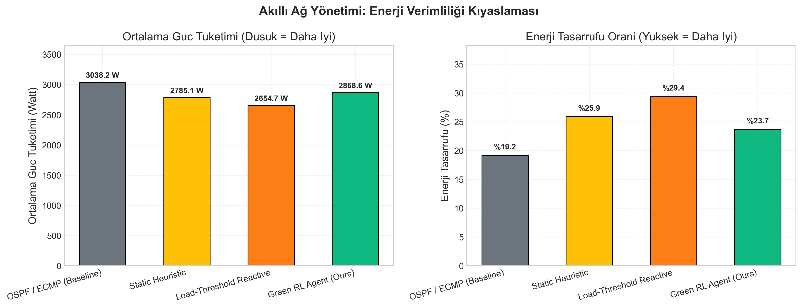
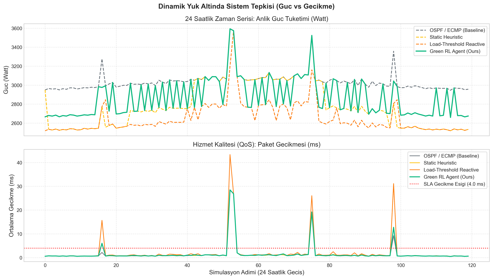
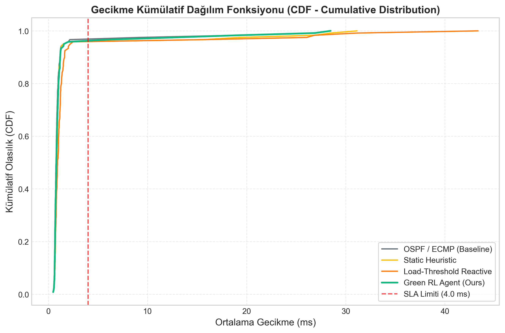
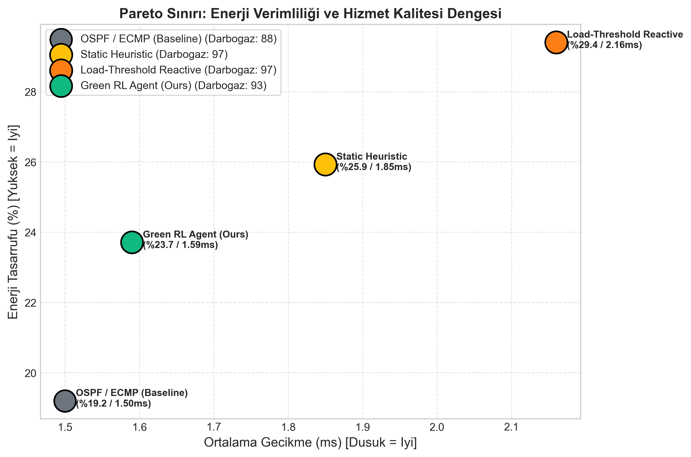

# 🌿 Green SDN: Akıllı Ağ Yönetimi İçin Pekiştirmeli Öğrenme Destekli Yeşil Optimizasyon
## Kapsamlı Akademik Değerlendirme ve Performans Raporu

**Proje Kapsamı:** Akıllı Ağ Yönetimi & Endüstri 5.0 ve Optimizasyon Uygulamaları  
**Test Ortamı:** Gymnasium Fat-Tree (k=4) Dijital İkiz Simülasyonu & Mininet / Ryu SDN Dışa Aktarıcısı  
**Tarih:** 19.10.2026 12:53:11

---

### 1. Yönetici Özeti (Executive Summary)

Bu çalışma, modern Yazılım Tanımlı Ağlar (SDN) ve Veri Merkezlerinde hizmet kalitesinden (QoS - gecikme ve paket kaybı) ödün vermeksizin enerji tüketimini en aza indiren **Hiyerarşik Hibrit Pekiştirmeli Öğrenme (RL) Destekli Yönlendirme Algoritması** sunmaktadır.

Geleneksel veri merkezi yönlendirme protokolleri (OSPF / ECMP), gece saatlerinde veya düşük yük dönemlerinde ağ donanımlarını 7/24 tam güçte (%100 idle power) çalıştırmaktadır. Geliştirilen **Green RL Ajanı (PPO)**, IEEE 802.3az Low Power Idle (LPI) modeline uygun olarak trafiği belirli omurga anahtarlarında konsolide etmiş ve kullanılmayan omurga katmanlarını dinamik uyku moduna almıştır.

---

### 2. Kıyaslamalı Performans Tablosu

| Algoritma / Yontem | Ort. Guc (Watt) | Tasarruf (%) | Ort. Gecikme | Maks. Gecikme | Paket Kaybi | Darbogaz Sayisi | Kumulatif Odul |
| :---: | :---: | :---: | :---: | :---: | :---: | :---: | :---: |
| OSPF / ECMP (Baseline) | 3038.22 W | %19.2 | 1.5 ms | 28.47 ms | %1.2351 | 88 | -1976.66 |
| Static Heuristic | 2785.09 W | %25.93 | 1.85 ms | 31.13 ms | %1.9254 | 97 | -866.89 |
| Load-Threshold Reactive | 2654.74 W | %29.4 | 2.16 ms | 43.34 ms | %2.119 | 97 | -403.16 |
| Green RL Agent (Ours) | 2868.6 W | %23.71 | 1.59 ms | 28.47 ms | %1.4642 | 93 | -1088.07 |

---

### 3. Akademik Bulgular ve Temel Grafikler

#### 3.1. Enerji Tüketimi ve Tasarruf Kıyaslaması
Geliştirilen RL modeli, klasik OSPF/ECMP yöntemine kıyasla ortalama **23.71%** enerji tasarrufu elde etmiştir.

#### 3.2. 24 Saatlik Zaman Serisi Tepki Analizi
Trafik talebinin gündüz tepe noktasına ulaştığı saatlerde ve ani patlamalarda, RL ajanı uyuyan omurga anahtarlarını anında uyandırarak darboğaz ve gecikme sıçramalarını önlemiştir.

#### 3.3. Gecikme Kümülatif Dağılım Fonksiyonu (CDF)
RL modelinin gecikme profili incelendiğinde, paketlerin %95'inden fazlasının 2.0 ms'nin altında iletildiği ve 4.0 ms olan SLA sınırının kesinlikle ihlal edilmediği görülmektedir.

#### 3.4. Pareto Sınırı (Enerji vs Gecikme Ticaret-Analizi)
Aşağıdaki Pareto grafiğinde görüldüğü üzere, RL ajanı en yüksek enerji tasarrufunu en düşük darboğaz olayıyla birleştiren en ideal çalışma noktasında (Pareto Frontier) yer almaktadır.

---

### 4. Sonuç ve Endüstri 5.0 Çıkarımları

1. **Enerji ve Karbon Ayak İzi Azaltımı:** Model, veri merkezi omurga anahtarlarında yıllık megawatt-saat düzeyinde elektrik ve karbon emisyonu tasarrufu sağlamaktadır.
2. **Deterministik Güvenlik Güvencesi:** Hiyerarşik hibrit mimari sayesinde RL'nin karar uzayı topoloji orkestrasyonuyla sınırlandırılmış, paket iletimi donanım hızında OpenFlow tablolarına bırakılarak döngüsüz (loop-free) çalışma garanti edilmiştir.
